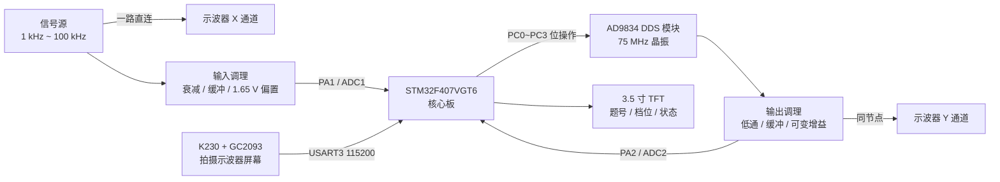

# 硬件清单与实物说明

本文件说明这套装置由哪些硬件组成、各自负责什么、哪些是买来的成品模块、哪些是自己搭的。
引脚连接见 [README 第 3 节](../README.md#3-硬件)，此处不重复。

---

## 1. 系统组成

闭环里有两处模拟环节（输入调理、输出调理）是装置自己搭的，其余为成品模块。
**相位不是在代码里闭合的**：程序改 DDS 频率，相位差在模拟电路里改变，下一帧再从 PA2 采回来。

---

## 2. 主控

| 项 | 内容 |
|---|---|
| 芯片 | STM32F407VGT6，Cortex-M4F，168 MHz，1 MB Flash / 192 KB RAM |
| 开发板 | 市售 F407 核心板（板载 3.5 寸 TFT 排母、SWD、USB 转串口），丝印 **M4 核心板 V3.0** |
| 显示 | 3.5 寸 TFT，480 × 320，FSMC 16 位并口，插核心板排母 |
| 时钟源 | 外部 HSE 25 MHz（`main.c` 中 PLLM=25 / PLLN=336 / PLLP=2 得 168 MHz） |
| 调试 | SWD：PA13 / PA14，建议同时接 NRST |

用到的片上外设：ADC1 + ADC2（双路同步）、TIM3（触发源）、DMA2（双通道循环）、
USART1（日志）、USART3（K230）、FSMC（屏幕）、GPIO（按键 / DDS 位操作 / 输出选档）。

> 换其他 F407 板子也能跑，只需确认：两路 ADC 引脚可用、PC0~PC3 未被占用、
> TFT 接口一致（不一致就改 `tft_display.c` 的底层写函数）。`.ioc` 仅供参考，不要用它重新生成代码。

---

## 3. DDS：AD9834 模块

| 项 | 内容 |
|---|---|
| 芯片 | AD9834，10 位 DAC，28 位频率字，最高 75 MHz 主时钟 |
| 模块 | 成品 AD9834 DDS 模块，板载 **75 MHz 有源晶振** |
| 频率分辨率 | 75 MHz / 2²⁸ ≈ **0.279 Hz** |
| 接口 | 三线串行（SDATA / SCLK / FSYNC）+ RESET，本工程用 GPIO 位操作模拟 |
| 输出 | 电流型 DAC 输出，**必须外部 I/V 转换 + 低通滤波**才能接示波器 |

接线：`PC0 → SDATA`、`PC1 → SCLK`、`PC2 → FSYNC`、`PC3 → RESET`。

**两个易踩的坑：**

1. **晶振频率写死在代码里**。`Core/Inc/ad9834_gpio_f407.h` 的
   `AD9834_GPIO_DEFAULT_MCLK_HZ` 默认 75 MHz。换模块或换晶振必须同步改，
   否则输出频率整体成比例偏移，而屏幕上什么都看不出来——只是图形锁不住。
2. **幅度不受软件控制**。AD9834 只能设频率和相位，幅度靠外部可变增益级，
   由 PB4~PB7 选档（对应示波器 2/4/6/8 格）。所以第 4 题是硬件选档，不是软件调幅。

驱动源码：`Core/Src/ad9834_gpio_f407.c`（按库使用，不必读实现）。

---

## 4. 视觉子机：K230

| 项 | 内容 |
|---|---|
| 主控 | 嘉楠 CanMV K230（RISC-V，双核 + KPU） |
| 摄像头 | GC2093，接 K230 的 MIPI-CSI |
| 运行环境 | CanMV 固件，直接运行 `K230/main.py`（MicroPython） |
| 与主控通信 | USART3，115200-8-N-1：`PB10 → K230 RX`、`PB11 ← K230 TX`、共地 |

**职责划分**：K230 只负责「拍示波器屏幕 → 判断当前是斜线 / 圆 / 倒 8 → 上报频率」，
不参与锁相。真正的相位闭环仍在 STM32 侧。第五题进入方式：按 PA0 切模式，
STM32 停采样、AD9834 保持复位，改由三个外接键（PD12 / PD13 / PD3）分别启动三个小问。

**注意**：K230 与 STM32 必须共地，且 K230 的串口电平是 3.3 V——不要接 5 V 电平的 USB-TTL。

---

## 5. 自己搭的模拟部分

这两块没有原理图文件在仓库里（当时是洞洞板手搭），按下表复现即可。

### 5.1 输入调理（信号源 → PA1）

| 环节 | 作用 | 要点 |
|---|---|---|
| 交流耦合 + 偏置 | 把以 0 V 为中心的正弦抬到 1.65 V | 分压电阻取 1:1，两枚 10 kΩ |
| 限幅 | 防止过压打坏 ADC | 3.3 V 电源轨上加肖特基钳位 |
| 缓冲 | 降低信号源内阻影响 | 单运放跟随（如 OPA2350 / TL072，需轨到轨） |

**安全边界**：PA1 任何时刻必须满足 `0 V ≤ V ≤ 3.3 V`。直接接负压或 RS-232 电平会烧引脚。

### 5.2 输出调理（AD9834 → 示波器 Y 与 PA2）

| 环节 | 作用 | 要点 |
|---|---|---|
| I/V 转换 | AD9834 是电流输出 | 200 Ω 负载电阻到地即可出电压 |
| 低通滤波 | 滤掉 DDS 时钟泄漏与镜像 | 截止频率略高于 100 kHz，二阶足够 |
| 可变增益 | 实现 2/4/6/8 格四档 | 由 PB4~PB7 选通四路反馈电阻 |
| 分路 | 同一节点同时给示波器 Y 与 PA2 | **必须同一节点**，否则测到的相位不是屏幕上的相位 |

> 分路这一点很关键：PA2 采的必须是示波器看到的那个信号，中间不能再插缓冲级，
> 否则缓冲的相移会被算进闭环误差里，锁相环会去追一个不存在的偏差。

---

## 6. 物料清单

| # | 物料 | 规格 | 数量 | 说明 |
|---|---|---|---|---|
| 1 | STM32F407 核心板 | M4 核心板 V3.0，板载 TFT 排母 | 1 | 主控 |
| 2 | TFT 显示屏 | 3.5 寸，480×320，FSMC 并口 | 1 | 插核心板 |
| 3 | AD9834 DDS 模块 | 板载 75 MHz 有源晶振 | 1 | 信号合成 |
| 4 | K230 开发板 | CanMV K230 | 1 | 视觉子机 |
| 5 | 摄像头 | GC2093，MIPI-CSI | 1 | 对准示波器屏幕 |
| 6 | 运放 | 轨到轨双运放（OPA2350 / TL072 等） | 2 | 输入/输出调理 |
| 7 | 电阻电容 | 1% 金属膜，0805 或直插 | 若干 | 分压、滤波、反馈 |
| 8 | 按键 | 6×6 常开轻触 | 7 | PE2/PE3/PE4/PA0 + PD12/PD13/PD3 |
| 9 | 洞洞板 / 转接板 | 9×15 cm 或按需 | 1 | 模拟调理搭板 |
| 10 | 杜邦线 / 排线 | 母对母、公对母 | 若干 | 联调 |
| 11 | ST-Link | V2 或以上 | 1 | 烧录调试 |
| 12 | USB-TTL | CH340 / CP2102，3.3 V 电平 | 1 | 看串口日志 |

---

## 7. 实物照片

照片放在 `docs/images/`，README 与本文引用。建议拍这几张（每张压到 300 KB 以内）：

| 文件名 | 内容 | 为什么值得拍 |
|---|---|---|
| `board-overview.jpg` | 整机俯视，标出各模块位置 | 别人一眼看懂系统怎么拼起来 |
| `analog-frontend.jpg` | 输入/输出调理的洞洞板 | 这两块没有原理图，照片就是唯一资料 |
| `scope-locked.jpg` | 示波器上静止的李萨如图形 | 装置能用的直接证据 |
| `scope-infinity.jpg` | 二倍频的「∞」形 | 第 3 题完成情况 |
| `k230-setup.jpg` | K230 摄像头对准示波器屏幕 | 第五题的机械布置 |

拍的时候注意：**挡住示波器除屏幕外的面板**，这也正是赛题要求（避免拍到信号源操作面板）。

---

## 8. 换器件要注意什么

| 改动 | 必须同步改的地方 |
|---|---|
| 换 DDS 型号（如 AD9850 / AD9959） | 重写驱动层，`signal_app.c` 与 `dds_pll.c` 的调用接口保持 `SetFrequencyMilliHz` 语义即可 |
| DDS 晶振不是 75 MHz | `AD9834_GPIO_DEFAULT_MCLK_HZ` |
| 换主控（如 F411 / H743） | 定时器时钟、PLL 参数、DMA 通道、ADC 句柄全部要改；FFT 与锁相环逻辑可原样搬 |
| 换屏幕 | `tft_display.c` 底层读写函数 |
| 输入频段超出 1k~100k | `app_config.h` 的 `APP_INPUT_FREQUENCY_MIN/MAX_HZ`，并确认采样率上限与奈奎斯特 |

---

## 9. 资料出处（不上传厂商 PDF）

芯片手册、模块原理图属于厂商版权资料，不放进仓库。需要时按下面找：

| 资料 | 来源 |
|---|---|
| AD9834 datasheet | Analog Devices 官网，搜「AD9834」 |
| STM32F407 参考手册 / 数据手册 | ST 官网 `RM0090` / `DS8626` |
| K230 文档与 CanMV 固件 | 嘉楠开发者社区、CanMV 文档站 |
| CMSIS-DSP 文档 | ARM 官方 `CMSIS-DSP` 文档 |

仓库里只保留**我们自己的**接线表、参数表和代码——这也符合开源仓库的惯例。
