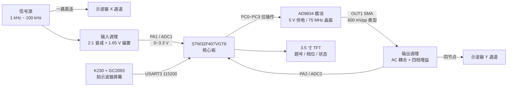
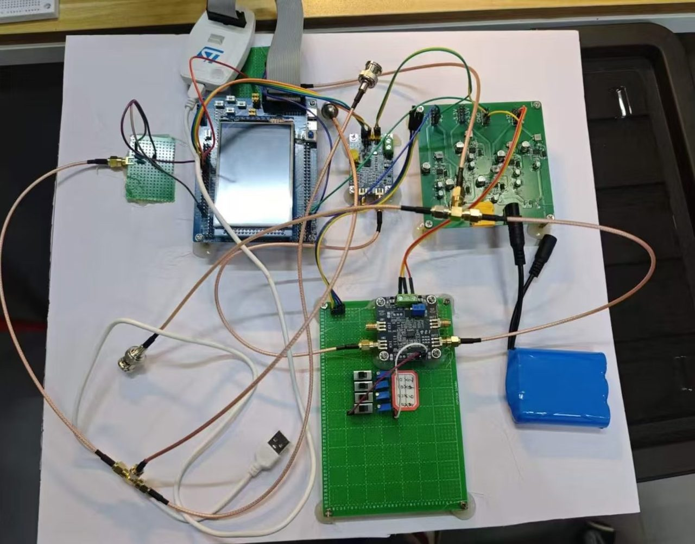
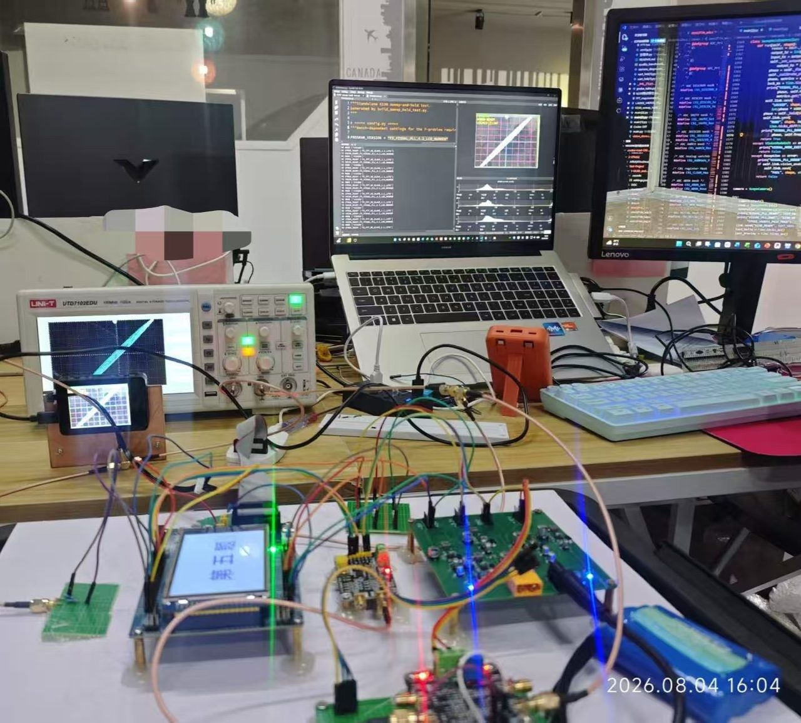
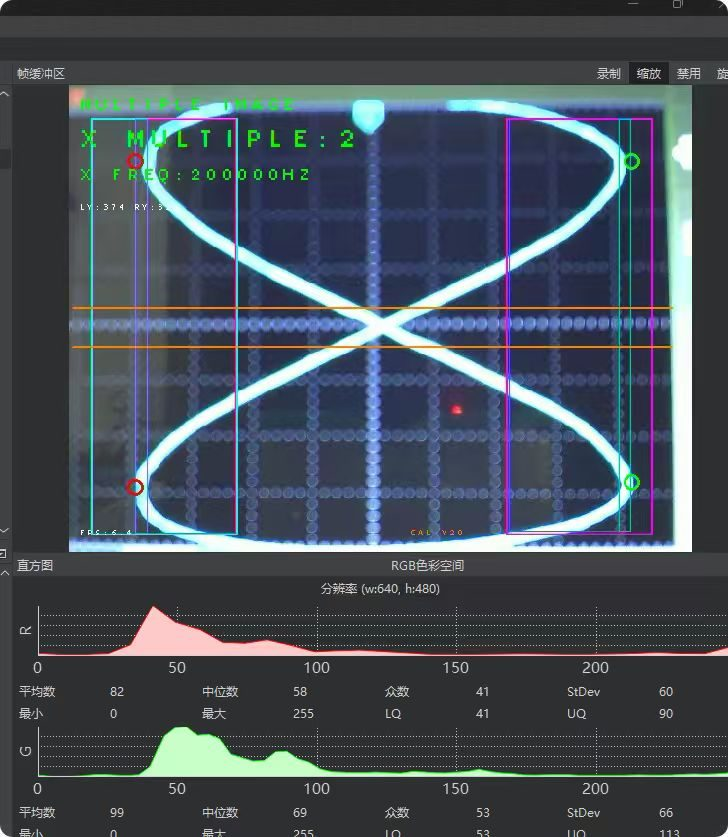

# 硬件清单与接线方案

本文件说明这套装置由哪些硬件组成、各自负责什么、哪些是买来的成品模块、哪些是自己搭的，
以及**为什么这么接**。引脚总表见 [README 第 3 节](../README.md#3-硬件)。

---

## 1. 系统组成

闭环里有两处模拟环节是自己搭的（输入调理、输出调理），其余全是成品模块。
**相位不是在代码里闭合的**：程序改 DDS 频率，相位差在模拟电路里改变，下一帧再从 PA2 采回来。

---

## 2. 主控

| 项 | 内容 |
|---|---|
| 芯片 | STM32F407VGT6，Cortex-M4F，168 MHz，1 MB Flash / 192 KB RAM |
| 开发板 | 市售 F407 核心板（板载 3.5 寸 TFT 排母、SWD、USB 转串口），丝印 **M4 核心板 V3.0** |
| 显示 | 3.5 寸 TFT，480 × 320，FSMC 16 位并口，插核心板排母 |
| 时钟源 | 外部 HSE 25 MHz（`main.c` 中 PLLM=25 / PLLN=336 / PLLP=2 得 168 MHz） |
| 调试 | SWD：PA13 / PA14，建议同时接 NRST |

用到的片上外设：ADC1 + ADC2（双路同步）、TIM3（触发源）、DMA2（双通道循环）、
USART1（日志）、USART3（K230）、FSMC（屏幕）、GPIO（按键 / DDS 位操作 / 输出选档）。

> 换其他 F407 板子也能跑，只需确认三件事：两路 ADC 引脚可用、PC0~PC3 未被占用、
> TFT 接口一致（不一致就改 `tft_display.c` 的底层写函数）。
> `.ioc` 仅供查阅，不要用它重新生成代码——会覆盖手写逻辑。

---

## 3. DDS：AD9834 模块

用的是成品模块（科一电子 DDS_A9834_V1.0，5.0 × 3.5 cm，双 SMA 输出）。
下面这些参数来自模块手册与原理图，**都是会影响程序行为的**，不是背景介绍。

| 项 | 参数 | 对程序的影响 |
|---|---|---|
| 供电 | **5 V**（上限 5.5 V），板上有 SGM2036-3.3 LDO 转 3.3 V | 用核心板 5 V 脚供电；**有反接保护但无过压保护**，接错会烧 |
| 数字电平 | DVDD = 3.3 V（LDO 供出） | STM32 的 3.3 V GPIO 可直连，无需电平转换 |
| 主时钟 | 板载 **75 MHz 有源晶振**（三态输出），不可更换 | 频率字按 75 MHz 算，换模块必须改代码里的宏 |
| 频率字 | 28 位，分辨率 75 MHz / 2²⁸ ≈ **0.279 Hz** | 写频死区取 0.5 Hz，必须大于一步 |
| DAC | 10 位 | 输出量化台阶约 1/1024 满量程 |
| 输出通道 | **OUT1 / OUT2 双路差分，相差 180°**，各经 LC 低通后到 SMA | 只用 OUT1；两路可做差分输出，本题不用 |
| 输出幅度 | 正弦/三角典型 **600 mVpp**，方波 3.3 Vpp | **远不够示波器 8 div（4 Vpp）**，必须外部放大 |
| 输出阻抗 | 200 Ω | 后级输入阻抗要远大于 200 Ω，否则幅度被拉低 |
| 直流分量 | 输出自带直流偏置 | 进 ADC 前必须 AC 耦合 |
| 幅度随频率 | 正弦/三角幅度**随频率升高而减小** | 高频档需要更大增益，四档幅度误差要按实际频点校 |
| 通信 | SPI（最高 40 MHz），本工程用 GPIO 位操作模拟 | 位操作速率远低于 40 MHz，够用且省一个 SPI 外设 |

### 3.1 接线

| 模块引脚 | 接到 | 说明 |
|---|---|---|
| VCC | 核心板 5 V | 不要接 3.3 V（LDO 压差不够会不稳） |
| GND | 公共地 | 必须与其他设备共地 |
| SDA | PC0 | 串行数据 |
| CLK | PC1 | 串行时钟 |
| SYNC | PC2 | 帧同步，低有效 |
| RST | PC3 | 复位 |
| FS / PS / SLP | 悬空 | 模块内部有下拉电阻，频率/相位/休眠选择不用 |
| OUT1 | 输出调理输入 | 只用这一路 |

### 3.2 两个易踩的坑

1. **晶振频率写死在代码里**。`Core/Inc/ad9834_gpio_f407.h` 的
   `AD9834_GPIO_DEFAULT_MCLK_HZ` 默认 75 MHz。换模块必须同步改，
   否则输出频率整体成比例偏移——而屏幕上什么都看不出来，只是图形锁不住。
2. **幅度不受软件控制**。AD9834 只能设频率和相位。第 4 题的四档幅度是
   **硬件选增益**（PB4~PB7），不是软件调幅。这也是为什么第 4 题换档后
   相位环要重新捕获——信号幅度变了，闭环看到的误差也变了。

---

## 4. 视觉子机：K230

| 项 | 内容 |
|---|---|
| 主控 | 嘉楠 CanMV K230（RISC-V 双核 + KPU） |
| 摄像头 | GC2093，接 K230 的 MIPI-CSI |
| 运行环境 | CanMV 固件（MicroPython），直接运行 `K230/main.py` |
| 通信引脚 | UART3：GPIO50 → STM32 PB11，GPIO51 ← STM32 PB10 |
| 参数 | 115200-8-N-1，**必须共地** |

**职责划分**：K230 只负责「拍屏幕 → 判断图形 → 上报频率并下命令」，
不参与锁相。真正的相位闭环仍在 STM32 侧。

**注意**：K230 串口是 3.3 V 电平，不要接 5 V 的 USB-TTL。

---

## 5. 自己搭的模拟部分

这两块当时是洞洞板手搭，没留原理图。下表按**题面指标反推**给出需求值，
实际电阻以实物为准——但需求是确定的，照着算就能复现。

### 5.1 输入调理（信号源 → PA1）

**要解决的问题**：信号源输出以 0 V 为中心、幅度最大到 4 Vpp（8 div × 0.5 V/div），
而 ADC 只能吃 0~3.3 V。

| 环节 | 做法 | 为什么 |
|---|---|---|
| 交流耦合 | 串联 1 µF | 隔掉信号源直流 |
| 衰减 | 2:1 分压（两枚 10 kΩ） | 4 Vpp 降到 2 Vpp，留出偏置余量 |
| 偏置 | 1.65 V（3.3 V 经等值电阻分压） | 让 0 V 落在 ADC 量程中点 |
| 限幅 | 3.3 V 轨上加肖特基钳位 | 防止误接高压打坏引脚 |
| 缓冲 | 轨到轨单运放跟随 | 降低信号源内阻影响，避免分压比被 ADC 采样电容拉偏 |

**衰减小了会削顶**（波形顶部被削平，测频仍准但测幅偏小）；**衰减大了不够灵敏**
（低于 124 码门限就判无效）。2:1 是这道题合适的折中。

### 5.2 输出调理（AD9834 → 示波器 Y 与 PA2）

**要解决的问题**：模块输出只有 600 mVpp，而示波器要 1~4 Vpp（2~8 div × 0.5 V/div），
所以需要**约 1.7~6.7 倍的可变增益**。

| 环节 | 做法 | 为什么 |
|---|---|---|
| AC 耦合 | 串联 1 µF | AD9834 输出带直流分量，不隔掉会把偏置带进后级 |
| 缓冲 | 轨到轨运放跟随 | 模块输出阻抗 200 Ω，直接带反馈网络会被拉低 |
| 可变增益 | 同相放大，四路反馈电阻由 PB4~PB7 选通 | 实现 2/4/6/8 格四档 |
| 分路 | 同一节点同时给示波器 Y 与 PA2 | **必须同一节点**，否则测到的相位不是屏幕上的相位 |

**四档增益需求**（按 600 mVpp 输入算，示波器 0.5 V/div）：

| 档位 | 示波器幅度 | 需要输出 | 需要增益 |
|---|---|---|---|
| 2 div | 1.0 Vpp | 1.0 Vpp | 1.67× |
| 4 div | 2.0 Vpp | 2.0 Vpp | 3.33× |
| 6 div | 3.0 Vpp | 3.0 Vpp | 5.00× |
| 8 div | 4.0 Vpp | 4.0 Vpp | 6.67× |

四档严格按 1:2:3:4 递进。题面要求幅度误差 ≤ 0.2 div，即 **±2.5%**，
用 1% 金属膜电阻足够；用 5% 碳膜电阻就会在 8 格档超差。

**分路这一点最关键**：PA2 采的必须是示波器看到的那个信号，中间不能再插缓冲级，
否则缓冲的相移会被算进闭环误差里，锁相环会去追一个不存在的偏差。

**选档为什么要一次性写 BSRR**：四路反馈电阻如果分两次写，中间会出现「全部断开」的瞬间，
增益变成开环，输出直接冲轨。一次写四位可以避免这个中间态在示波器上留下毛刺。

---

## 6. 物料清单

| # | 物料 | 规格 | 数量 | 说明 |
|---|---|---|---|---|
| 1 | STM32F407 核心板 | M4 核心板 V3.0，板载 TFT 排母 | 1 | 主控 |
| 2 | TFT 显示屏 | 3.5 寸，480×320，FSMC 并口 | 1 | 插核心板 |
| 3 | AD9834 DDS 模块 | 科一电子 DDS_A9834_V1.0，5 V 供电，双 SMA | 1 | 信号合成 |
| 4 | K230 开发板 | CanMV K230 | 1 | 视觉子机 |
| 5 | 摄像头 | GC2093，MIPI-CSI | 1 | 对准示波器屏幕 |
| 6 | 运放 | 轨到轨双运放（OPA2350 / TL072 等） | 2~3 | 输入/输出调理 |
| 7 | 电阻电容 | 1% 金属膜，0805 或直插 | 若干 | 分压、滤波、反馈 |
| 8 | 按键 | 6×6 常开轻触 | 7 | PE2/PE3/PE4/PA0 + PD12/PD13/PD3 |
| 9 | 洞洞板 | 9×15 cm 或按需 | 1~2 | 模拟调理搭板 |
| 10 | SMA 转 BNC 同轴线 | 50 Ω | 1~2 | 模块输出到示波器，屏蔽好 |
| 11 | 杜邦线 / 排线 | 母对母、公对母 | 若干 | 联调 |
| 12 | ST-Link | V2 或以上 | 1 | 烧录调试 |
| 13 | USB-TTL | CH340 / CP2102，3.3 V 电平 | 1 | 看串口日志 |

---

## 7. 实物照片

整套装置：STM32F407 主控、AD9834 DDS 模块、输入与输出调理板，右下是给装置单独供电的电池组。

联调现场：左边信号源与示波器，中间笔记本跑 FFT 频谱与 CanMV，前面是装置本体。

K230 拍到的示波器屏幕，此时是二倍频的「∞」形，彩色框是它自己画的边缘 ROI。

存放与压缩规则见 [`media.md`](media.md)。

---

## 8. 换器件要注意什么

| 改动 | 必须同步改的地方 |
|---|---|
| 换 DDS 型号（AD9850 / AD9959） | 重写驱动层，保持 `SetFrequencyMilliHz` 语义；`dds_pll.c` 不用动 |
| DDS 晶振不是 75 MHz | `AD9834_GPIO_DEFAULT_MCLK_HZ`，否则频率整体偏移 |
| 模块改 3.3 V 供电 | 先确认晶振与 LDO 是否还能工作；多数模块 3.3 V 下晶振起不来 |
| 换主控（F411 / H743） | 定时器时钟、PLL、DMA 通道、ADC 句柄全要改；FFT 与锁相环逻辑可原样搬 |
| 换屏幕 | `tft_display.c` 底层读写函数 |
| 输入频段超出 1k~100k | `app_config.h` 的 `APP_INPUT_FREQUENCY_MIN/MAX_HZ`，并确认采样率上限与奈奎斯特 |
| 示波器通道灵敏度不是 0.5 V/div | 四档增益的分压电阻要按新灵敏度重算 |

---

## 9. 资料出处（不上传厂商 PDF）

模块手册、芯片数据手册属厂商版权资料，不放进仓库。需要时按下面找：

| 资料 | 来源 |
|---|---|
| AD9834 datasheet | Analog Devices 官网，搜「AD9834」 |
| AD9834 模块原理图 / 手册 / 尺寸图 | 模块卖家资料包（科一电子，`qzkydz.taobao.com`） |
| STM32F407 参考手册 / 数据手册 | ST 官网 `RM0090` / `DS8626` |
| K230 文档与 CanMV 固件 | 嘉楠开发者社区、CanMV 文档站 |
| CMSIS-DSP 文档 | ARM 官方 `CMSIS-DSP` 文档 |

仓库只保留**我们自己写的**接线表、参数表、增益计算和代码——这也是开源仓库的惯例。
